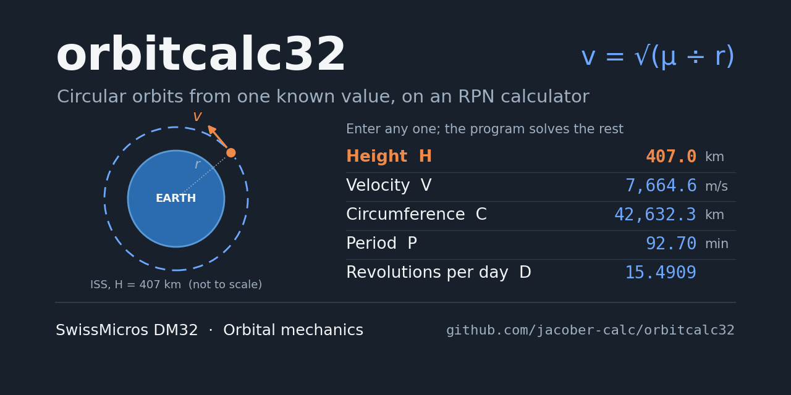
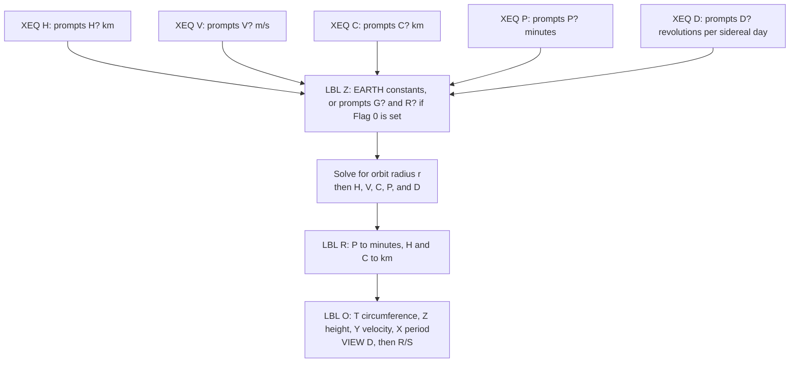
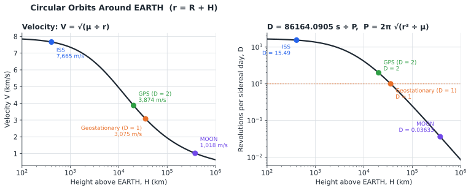
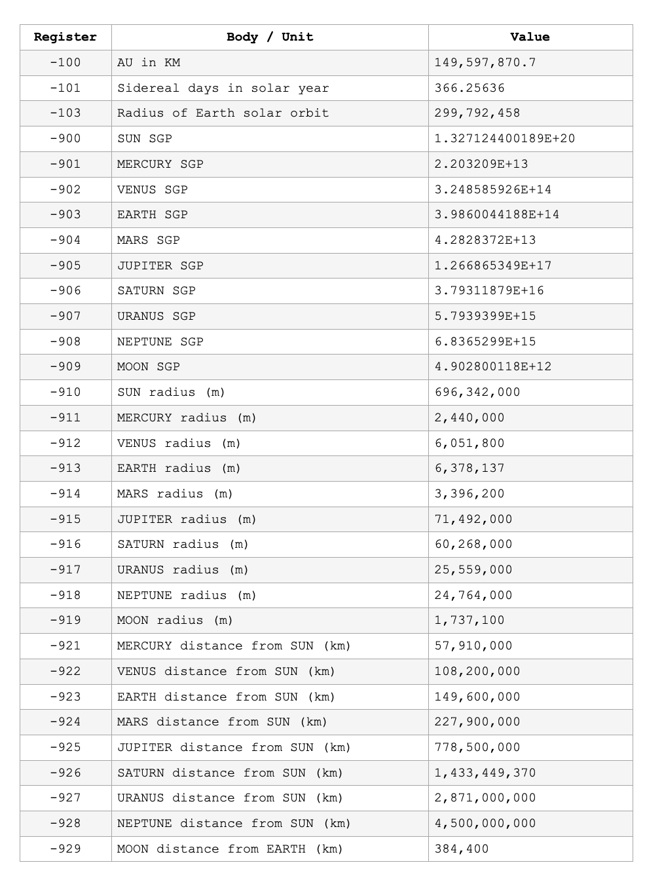
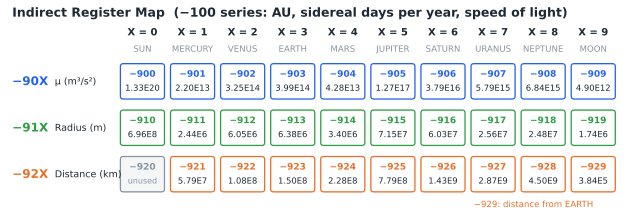
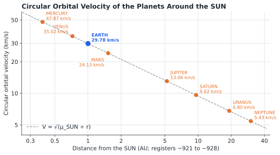

# orbitcalc Statefile

## TABLE OF CONTENTS

1. [Introduction](#1-introduction)
2. [Theory of Operations](#2-theory-of-operations)
3. [Variable Definitions](#3-variable-definitions)
4. [Program Descriptions](#4-program-descriptions)
5. [Operating Instructions](#5-operating-instructions)
6. [Example Calculations](#6-example-calculations)
7. [Quick Reference](#7-quick-reference)
8. [Program Listing](#8-program-listing)

---

## 1. INTRODUCTION

This program suite provides circular-orbit calculations for the SwissMicros DM32 calculator. From any one known orbital value (height, velocity, circumference, period, or revolutions per sidereal day) it calculates all of the others, and it stores gravitational parameters, radii, and distances for the SUN, the planets, and the MOON.

### 1.1 Purpose

The program enables users to:

- Calculate a circular orbit from any one of five known values
- Work around EARTH by default, or around any other body with a few keystrokes
- Recall stored constants for the SUN, all eight planets, and the MOON
- Compare orbits through the number of revolutions per sidereal day

### 1.2 System Requirements

SwissMicros DM32 calculator with RPN operating system. Program requires 268 program steps in 9 labels. Flag 0 selects whether the program prompts for the main body (section 5.2). The Solar System constants use DM32 Global registers.

### 1.3 Install and Download

Copy **ORBITCALC.d32** to the `/STATE` folder of the DM32's internal USB disk, then load it from the calculator. Instructions are available [via the DM32 User Manual](https://technical.swissmicros.com/dm32/doc/dm32_user_manual.html#_saving_and_loading_a_state).

After loading, press `[XEQ] [A]` once to store the Solar System constants (section 2.4).

---

## 2. THEORY OF OPERATIONS

### 2.1 Circular Orbits

For a circular orbit of radius r around a body with gravitational parameter μ (G) and radius R:

```
r = R + H                     Orbit radius from the body's centre
V = √(G ÷ r)                  Orbital velocity, m/s
C = 2π r                      Circumference
P = 2π √(r³ ÷ G)              Period, s
D = 86164.0905 ÷ P            Revolutions per sidereal day
```

One sidereal day, 86,164.0905 seconds, is the time the EARTH takes to turn once relative to the stars. D = 1 is therefore an orbit that keeps pace with the EARTH's rotation: the geostationary orbit.

### 2.2 Initiator Programs

Each initiator program prompts for the one value it is named for, solves for the orbit radius, and calculates the rest. LBL R then converts the results to display units and LBL O displays them.



The charts show how velocity and D change with height around the EARTH. Higher orbits are slower and complete fewer revolutions: the ISS makes about 15.5 revolutions per sidereal day, the GPS satellites 2, and a geostationary satellite exactly 1.



### 2.3 Choosing the Main Body

LBL Z sets the main body for every calculation:

- **Flag 0 clear** (default): G and R are set to the EARTH's values with no prompts.
- **Flag 0 set**: LBL Z prompts **G?** and **R?**. At each prompt, the EARTH's value is in the Y register and the MOON's in the Z register, so `[R↓]` once selects the EARTH and twice selects the MOON. Any other body can be recalled from the Global registers (section 2.4), and a value typed at the prompt is used as entered. Pressing `[R/S]` without changing the prompt keeps the previous value, which makes it quick to run several calculations around the same body.

### 2.4 Solar System Constants

LBL A stores gravitational parameters, radii, and distances for the SUN, the planets, and the MOON in Global registers. Global registers are shared by all States and survive CLEAR VARS, but they are cleared by a RESET or firmware update, which is why LBL A is included to restore them.

Universal constants are stored in the −100 series and all other constants in the −900 series. Each body has a fixed digit: the SUN is always X = 0, the planets follow their order from the SUN (MERCURY 1, VENUS 2, EARTH 3, MARS 4, JUPITER 5, SATURN 6, URANUS 7, NEPTUNE 8), and the MOON is 9.

| Register | Contents |
|----------|----------|
| −100 | Astronomical unit, 149,597,870.7 km |
| −101 | Sidereal days per sidereal year, 366.25636 |
| −102 | Speed of light, 299,792,458 m/s |
| −90X | Gravitational parameter μ of body X, m³/s² |
| −91X | Radius of body X, m |
| −92X | Distance of body X from the SUN, km (−929: MOON from EARTH) |





To recall a constant, for example the SUN's μ:

```
900 [+/-] [STO] [i]
[RCL] [(i)]
```

The same formula, V = √(μ ÷ r), gives the circular orbital velocity at each planet's distance from the SUN. On a log-log scale the planets fall on a single straight line: velocity falls with the square root of distance.



---

## 3. VARIABLE DEFINITIONS

| Variable | Description |
|----------|-------------|
| **G** | Gravitational parameter μ of the main body, m³/s² |
| **R** | Radius of the main body, m |
| **H** | Height of the orbit above the body's surface (km displayed) |
| **V** | Orbital velocity, m/s |
| **C** | Circumference of the orbit (km displayed) |
| **P** | Orbital period (minutes displayed) |
| **D** | Revolutions per sidereal day |
| **i** | Index register (LBL A and constant recall) |

---

## 4. PROGRAM DESCRIPTIONS

### 4.1 Initiator Programs

| Label | Known value | Prompt | Units |
|-------|-------------|--------|-------|
| **H** | Height above the main body | H? | km |
| **V** | Orbital velocity | V? | m/s |
| **C** | Circumference | C? | km |
| **P** | Period | P? | minutes |
| **D** | Revolutions per sidereal day | D? | (none) |

Each initiator then runs LBL Z (G? and R? prompts if Flag 0 is set) and finishes with the results display.

**Outputs (Stack display from top to bottom):**
- T: Circumference, km
- Z: Height, km
- Y: Velocity, m/s
- X: Period, minutes
- VIEW: D, revolutions per sidereal day (press `[R/S]` to continue)

### 4.2 Supporting Programs

- **LBL A:** Stores the Solar System constants in Global registers (run once after loading or after a RESET)
- **LBL Z:** Sets the main body (internal)
- **LBL R:** Converts results to display units, then runs LBL O (internal; do not run on its own, as it converts again)
- **LBL O:** Displays the results (can be run on its own to display the last results again)

---

## 5. OPERATING INSTRUCTIONS

### 5.1 Calculating an Orbit Around the EARTH

**Procedure:**
```
1. Press [XEQ] and the initiator letter (H, V, C, P, or D)
2. Key in the known value at the prompt and press [R/S]
3. D is displayed; press [R/S] to see the results on the stack
```

### 5.2 Calculating an Orbit Around Another Body

**Procedure:**
```
1. Press [SF] [0]
2. Press [XEQ] and the initiator letter
3. Key in the known value and press [R/S]
4. At G?: [R↓] for EARTH, [R↓] [R↓] for MOON, or recall
   another body's μ (e.g. 900 [+/-] [STO] [i] [RCL] [(i)]); press [R/S]
5. At R?: select the matching radius the same way
   (e.g. 910 [+/-] [STO] [i] [RCL] [(i)]); press [R/S]
6. D is displayed; press [R/S] to see the results
```

Flag 0 stays set until cleared with `[CF] [0]`, which returns the programs to the EARTH defaults.

---

## 6. EXAMPLE CALCULATIONS

Results are shown in FIX 6, the display format saved in the Statefile.

### 6.1 International Space Station

**Problem:** The ISS orbits at a mean height of about 407 km. Find its velocity, circumference, period, and revolutions per sidereal day.

**Solution:**
```
[XEQ] [H]
H?  407 [R/S]
D=15.490927   [R/S]
```

**Results (displayed on screen from top to bottom):**

| Register | Value | Meaning |
|----------|-------|---------|
| T | 42,632.273106 | Circumference, km |
| Z | 407.000000 | Height, km |
| Y | 7,664.601457 | Velocity, m/s |
| X | 92.703827 | Period, minutes |

**Interpretation:** The ISS travels at about 7.66 km/s and circles the EARTH in 92.7 minutes, about 15.5 times per sidereal day. Its orbit is not perfectly circular, but its eccentricity is low enough that the circular-orbit values are very close to the real ones.

**Any initiator gives the same orbit.** Entering any of the results above in its own initiator returns the same height of 407.000000 km:

| Keys | Prompt input |
|------|--------------|
| `[XEQ] [V]` | 7664.601457 |
| `[XEQ] [C]` | 42632.273106 |
| `[XEQ] [P]` | 92.703827 |

### 6.2 Geostationary Orbit

**Problem:** At what height does a satellite complete exactly one revolution per sidereal day?

**Solution:**
```
[XEQ] [D]
D?  1 [R/S]
D=1.000000    [R/S]
```

**Results:**

| Register | Value | Meaning |
|----------|-------|---------|
| T | 264,925.291089 | Circumference, km |
| Z | 35,786.032627 | Height, km |
| Y | 3,074.660100 | Velocity, m/s |
| X | 1,436.068175 | Period, minutes |

**Interpretation:** A satellite 35,786 km above the equator keeps pace with the EARTH's rotation and appears fixed in the sky.

### 6.3 The EARTH Around the SUN

**Problem:** The EARTH completes one orbit of the SUN in 366.25636 sidereal days, so it makes 1 ÷ 366.25636 revolutions per sidereal day. Treating its orbit as a circle, find its distance and speed.

**Solution:**
```
[SF] [0]
[XEQ] [D]
D?  101 [+/-] [STO] [i] [RCL] [(i)] [1/x] [R/S]     (1 ÷ 366.25636)
G?  900 [+/-] [STO] [i] [RCL] [(i)] [R/S]           (SUN μ)
R?  910 [+/-] [STO] [i] [RCL] [(i)] [R/S]           (SUN radius)
D=0.002730    [R/S]
```

**Results:**

| Register | Value | Meaning |
|----------|-------|---------|
| T | 939,950,152.947581 | Circumference, km |
| Z | 148,901,371.101591 | Height above the SUN's surface, km |
| Y | 29,784.707521 | Velocity, m/s |
| X | 525,969.102487 | Period, minutes |

**Interpretation:** The height is measured from the SUN's surface. Adding the SUN's radius of 696,342 km gives an orbit radius of 149,597,713 km, within 158 km (0.0001%) of the astronomical unit stored in register −100. The low eccentricity of the EARTH's orbit makes the circular-orbit values a close match for its real distance and its mean speed of about 29.78 km/s.

### 6.4 Low Lunar Orbit

**Problem:** Find the velocity and period of a spacecraft orbiting 100 km above the MOON.

**Solution:**
```
[SF] [0]
[XEQ] [H]
H?  100 [R/S]
G?  [R↓] [R↓] [R/S]          (MOON μ)
R?  [R↓] [R↓] [R/S]          (MOON radius)
D=12.194650   [R/S]
```

**Results:**

| Register | Value | Meaning |
|----------|-------|---------|
| T | 11,542.839728 | Circumference, km |
| Z | 100.000000 | Height, km |
| Y | 1,633.637505 | Velocity, m/s |
| X | 117.762148 | Period, minutes |

**Interpretation:** At 1.63 km/s, a spacecraft circles the MOON in just under two hours, close to the orbit flown by the APOLLO command modules.

---

## 7. QUICK REFERENCE

### 7.1 Program Summary

| Label | Function |
|-------|----------|
| **H** | Orbit from height (km) |
| **V** | Orbit from velocity (m/s) |
| **C** | Orbit from circumference (km) |
| **P** | Orbit from period (minutes) |
| **D** | Orbit from revolutions per sidereal day |
| **A** | Store Solar System constants |
| **O** | Display the last results again |

### 7.2 Results

| Register | Value |
|----------|-------|
| VIEW | D, revolutions per sidereal day |
| T | Circumference, km |
| Z | Height, km |
| Y | Velocity, m/s |
| X | Period, minutes |

### 7.3 Important Notes

- With Flag 0 clear, every calculation is around the EARTH; set Flag 0 to choose another body
- Height is measured from the main body's surface; add R for the distance from its centre
- Run LBL A after loading the Statefile and after any RESET or firmware update
- D is revolutions per sidereal day; enter 1 ÷ (period in sidereal days) for long orbits
- Do not run LBL R directly; it would convert the stored values a second time
- Calculations assume a circular orbit; for low-eccentricity orbits the results are close to real values

---

## 8. PROGRAM LISTING

The complete program listing is provided below. Program steps are shown in standard DM32 RPN format with label-relative line numbers, as displayed on the calculator. The DM32 does not generate checksums.

### LBL O - Results Display

```
O01  LBL O                  Results display.
O02  RCL P                  Period,
O03  RCL C                  circumference,
O04  RCL H                  height,
O05  RCL V                  velocity,
O06  RCL P                  period: stack T: C, Z: H, Y: V, X: P.
O07  VIEW D                 Displays D; press R/S.
O08  RTN
```

### LBL R - Display Units

```
R01  LBL R                  Converts results to display units.
R02  RCL P
R03  60
R04  ÷                      Period, s to minutes.
R05  STO P
R06  RCL H
R07  1000
R08  ÷                      Height, m to km.
R09  STO H
R10  RCL C
R11  1000
R12  ÷                      Circumference, m to km.
R13  STO C
R14  GTO O                  Displays results.
```

### LBL Z - Main-Body Constants

```
Z01  LBL Z                  Main-body constants.
Z02  CLx
Z03  ENTER
Z04  4.902800118E12         μ of MOON, m³/s².
Z05  3.9860044188E14        μ of EARTH, m³/s².
Z06  FS? 0                  Flag 0 set?
Z07  INPUT G                Then prompts for μ.
Z08  STO G                  Stores μ in G (EARTH if not prompted).
Z09  CLx
Z10  ENTER
Z11  ENTER
Z12  1737100                Radius of MOON, m.
Z13  6378137                Radius of EARTH, m.
Z14  FS? 0                  Flag 0 set?
Z15  INPUT R                Then prompts for radius.
Z16  STO R                  Stores radius in R.
Z17  RTN
```

### LBL H - Height Initiator

```
H01  LBL H                  Initiator: height known.
H02  INPUT H                Prompts for height, km.
H03  1000
H04  ×                      km to m.
H05  STO H
H06  XEQ Z                  Main-body constants.
H07  SQRT(G÷(R+H))          Velocity, m/s.
H08  STO V
H09  (2×π)×(R+H)            Circumference, m.
H10  STO C
H11  (2×π)×SQRT((R+H)^3÷G)  Period, s.
H12  STO P
H13  (P÷86164.0905)
H14  1/x                    Revolutions per sidereal day.
H15  STO D
H16  GTO R                  Converts and displays.
```

### LBL V - Velocity Initiator

```
V01  LBL V                  Initiator: velocity known.
V02  INPUT V                Prompts for velocity, m/s.
V03  XEQ Z                  Main-body constants.
V04  (G÷V^2)-R              Height, m.
V05  STO H
V06  (2×π)×(R+H)            Circumference, m.
V07  STO C
V08  (2×π)×SQRT((R+H)^3÷G)  Period, s.
V09  STO P
V10  (P÷86164.0905)
V11  1/x                    Revolutions per sidereal day.
V12  STO D
V13  GTO R                  Converts and displays.
```

### LBL P - Period Initiator

```
P01  LBL P                  Initiator: period known.
P02  INPUT P                Prompts for period, minutes.
P03  60
P04  ×                      Minutes to s.
P05  STO P
P06  XEQ Z                  Main-body constants.
P07  RCL P
P08  2
P09  π
P10  ×
P11  ÷                      P ÷ 2π.
P12  x²
P13  RCL G
P14  ×                      μ(P ÷ 2π)².
P15  3
P16  ˣ√y                    Orbit radius r.
P17  RCL R
P18  -                      Height, m.
P19  STO H
P20  SQRT(G÷(R+H))          Velocity, m/s.
P21  STO V
P22  (2×π)×(R+H)            Circumference, m.
P23  STO C
P24  (P÷86164.0905)
P25  1/x                    Revolutions per sidereal day.
P26  STO D
P27  GTO R                  Converts and displays.
```

### LBL D - Revolutions Initiator

```
D01  LBL D                  Initiator: revolutions per sidereal day.
D02  INPUT D                Prompts for D.
D03  1/x
D04  STO D                  Stores 1 ÷ D.
D05  XEQ Z                  Main-body constants.
D06  D×86164.0905           Period, s.
D07  STO P
D08  2
D09  π
D10  ×
D11  ÷                      P ÷ 2π.
D12  x²
D13  RCL G
D14  ×                      μ(P ÷ 2π)².
D15  3
D16  ˣ√y                    Orbit radius r.
D17  RCL R
D18  -                      Height, m.
D19  STO H
D20  SQRT(G÷(R+H))          Velocity, m/s.
D21  STO V
D22  (2×π)×(R+H)            Circumference, m.
D23  STO C
D24  RCL D
D25  1/x                    Restores D.
D26  STO D
D27  GTO R                  Converts and displays.
```

### LBL C - Circumference Initiator

```
C01  LBL C                  Initiator: circumference known.
C02  INPUT C                Prompts for circumference, km.
C03  1000
C04  ×                      km to m.
C05  STO C
C06  XEQ Z                  Main-body constants.
C07  C÷(2×π)-R              Height, m.
C08  STO H
C09  SQRT(G÷(R+H))          Velocity, m/s.
C10  STO V
C11  (2×π)×SQRT((R+H)^3÷G)  Period, s.
C12  STO P
C13  (P÷86164.0905)
C14  1/x                    Revolutions per sidereal day.
C15  STO D
C16  GTO R                  Converts and displays.
```

### LBL A - Solar System Constants

```
A01  LBL A                  Solar System constants.
A02  -100
A03  STO i
A04  149597870.7            Astronomical unit, km.
A05  STO(i)
A06  -101
A07  STO i
A08  366.25636              Sidereal days per sidereal year.
A09  STO(i)
A10  -900                   μ of SUN through MOON,
A11  STO i                  registers -900 to -909.
A12  1.327124400189E20
A13  STO(i)
A14  -901
A15  STO i
A16  2.203209E13
A17  STO(i)
A18  -902
A19  STO i
A20  3.248585926E14
A21  STO(i)
A22  -903
A23  STO i
A24  3.9860044188E14
A25  STO(i)
A26  -904
A27  STO i
A28  4.2828372E13
A29  STO(i)
A30  -905
A31  STO i
A32  1.266865349E17
A33  STO(i)
A34  -906
A35  STO i
A36  3.79311879E16
A37  STO(i)
A38  -907
A39  STO i
A40  5.7939399E15
A41  STO(i)
A42  -908
A43  STO i
A44  6.8365299E15
A45  STO(i)
A46  -909
A47  STO i
A48  4.902800118E12
A49  STO(i)
A50  -910                   Radius of SUN through MOON,
A51  STO i                  registers -910 to -919.
A52  696342000
A53  STO(i)
A54  -911
A55  STO i
A56  2440000
A57  STO(i)
A58  -912
A59  STO i
A60  6051800
A61  STO(i)
A62  -913
A63  STO i
A64  6378137
A65  STO(i)
A66  -914
A67  STO i
A68  3396200
A69  STO(i)
A70  -915
A71  STO i
A72  71492000
A73  STO(i)
A74  -916
A75  STO i
A76  60268000
A77  STO(i)
A78  -917
A79  STO i
A80  25559000
A81  STO(i)
A82  -918
A83  STO i
A84  24764000
A85  STO(i)
A86  -919
A87  STO i
A88  1737100
A89  STO(i)
A90  -921                   Distance of MERCURY through
A91  STO i                  NEPTUNE from SUN, -921 to -928.
A92  57910000
A93  STO(i)
A94  -922
A95  STO i
A96  108200000
A97  STO(i)
A98  -923
A99  STO i
A100 149600000
A101 STO(i)
A102 -924
A103 STO i
A104 227900000
A105 STO(i)
A106 -925
A107 STO i
A108 778500000
A109 STO(i)
A110 -926
A111 STO i
A112 1433449370
A113 STO(i)
A114 -927
A115 STO i
A116 2871000000
A117 STO(i)
A118 -928
A119 STO i
A120 4500000000
A121 STO(i)
A122 -929                   Distance of MOON from EARTH, -929.
A123 STO i
A124 384400
A125 STO(i)
A126 CLx                    Clears stack.
A127 ENTER
A128 ENTER
A129 ENTER
A130 RTN
```

---

## Dedication

This humble Statefile and the tremendous (and often tedious) work that went into making it possible is dedicated to the vision and efforts of the thousands of unnamed individuals who contributed to the GEMINI and APOLLO programs culminating in landing man on the moon in the 20th century. Much of what we nerd out on and enjoy today by way of technology can be traced to their work and effort to put a man on the moon and we remain forever in their debt.

### By jacober-calc for SwissMicros DM32

> - [SwissMicros Website](https://www.swissmicros.com)
> - [DM32 product page](https://www.swissmicros.com/en/products/dm32)
> - [SwissMicros full products page](https://www.swissmicros.com/en/shop)
> - [DM32 Online User Manual](https://technical.swissmicros.com/dm32/doc/dm32_user_manual.html)
> - [SwissMicros Calculator Forum](https://forum.swissmicros.com/index.php)
